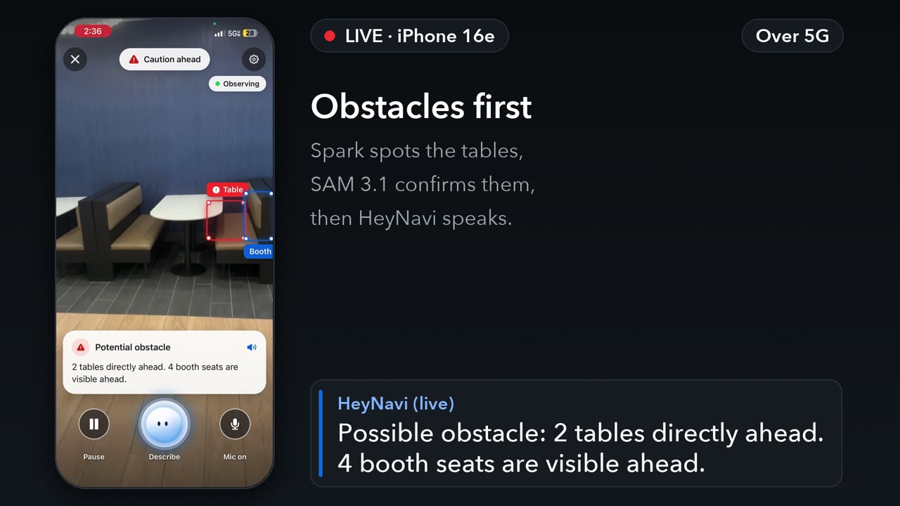

# HeyNavi

**See more. Go further.** HeyNavi is a voice-first AI environmental-awareness companion for blind and low-vision people. You start it and point the camera ahead. HeyNavi interprets the scene on its own, decides what is worth mentioning, and tells you. You can interrupt it, ask questions in plain English, or ask it to find a specific object.

Built for the Meta Global AI Developer Hackathon 2026 (Indie Developer Track, theme: *Build for Your World*).

> **Status (2026-11-03): demo build.** On an iPhone 16e, HeyNavi starts observing as soon as the camera opens. Muse Spark reads the view every few seconds and picks what could get in the way of someone walking; SAM 3.1 locates and confirms those objects; HeyNavi says them out loud ("Possible obstacle: a chair ahead on your left", "Steps are visible ahead") and outlines them on the preview. You can ask in plain English ("What's in front of me?", "Where is the exit?"), even while HeyNavi is talking, and "Find a chair" runs the object search. A **decision panel** (Settings › Advanced) shows the agent loop live. The UI (a frosted HeyNavi orb, full-screen camera, SAM boxes that stay on their objects as the phone turns) and a release build on cellular are tested.

## Demo video

**[Watch the demo on YouTube (2:20)](https://youtu.be/DVV_GXIN-uU)** · [MP4 in this repo (1080p)](docs/assets/heynavi-demo.mp4) · captions: [heynavi-demo.srt](docs/assets/heynavi-demo.srt). Every phone shot is a real screen recording from the iPhone 16e (hallway, lobby, stairwell; the lobby scenes run over 5G). Skipped waits are marked ("+7 s"), and a few frames are held still or blurred to hide lines HeyNavi did not say aloud and campus signs. The narration is an AI voice; see "Built with".

## Run it yourself

HeyNavi is an **iPhone app** (iOS only; Android is untested) with a small Python backend that runs on a Mac and holds the Meta API key.

**You need:** a Mac with Xcode 27 and CocoaPods, Node 24, Python 3.12 or newer (developed on 3.14.7), an iPhone (developed on an iPhone 16e) with a free or paid Apple developer account, and a Meta Model API key with access to `muse-spark-1.3` and `sam-3.1`. For use away from your Wi-Fi, also `cloudflared` (`brew install cloudflared`).

**First-time setup.** Each step starts in the repo root (open a new terminal tab, or `cd` back, between steps):

1. Backend: `cd backend && python3.12 -m venv .venv && .venv/bin/pip install -c constraints.txt -e '.[dev]'` (any `python3.X` of 3.12 or newer works; macOS's own `/usr/bin/python3` is 3.9 and the install fails with it). Then `cp .env.example .env`, paste your key after `MODEL_API_KEY=`, and set `HEYNAVI_APP_TOKEN` to a random value (`python3 -c "import secrets; print(secrets.token_urlsafe(24))"`). Details: [backend/README.md](backend/README.md).
2. App: `cd apps/mobile && npm install` (this also applies the React Native patch in `patches/`). Then `cp .env.example .env` and set `EXPO_PUBLIC_API_URL` to the Mac's LAN address (`ipconfig getifaddr en0`, port 8000) and `EXPO_PUBLIC_HEYNAVI_TOKEN` to the same value as `HEYNAVI_APP_TOKEN`.
3. Signing: `apps/mobile/app.json` carries this project's bundle identifier and Apple team. Change `ios.bundleIdentifier` to a unique one of your own (for example `com.yourname.heynavi`). Then either set `ios.appleTeamId` to your team ID, or pick your team in Xcode: `cd apps/mobile && npx expo prebuild --platform ios && open ios/HeyNavi.xcworkspace`, then choose it under the HeyNavi target › Signing & Capabilities › Team. The build script generates `apps/mobile/ios/` only when it is missing, so after any later change to `app.json` run `npx expo prebuild --platform ios --clean` (this also resets a team picked in Xcode). The tunnel script opens the app by its bundle identifier (`backend/scripts/start-tunnel.sh`, `com.heynavi.hackathon2026`), so change it there too.
4. iPhone and Xcode: sign in with your Apple ID in Xcode › Settings › Accounts (the build uses automatic signing). Connect the iPhone by cable, unlock it and tap Trust, then turn on Settings › Privacy & Security › Developer Mode (the phone restarts). With a free Apple ID, the first launch is blocked until you trust your certificate in Settings › General › VPN & Device Management. Keep the iPhone on the same Wi-Fi as the Mac, and allow Local Network access when HeyNavi asks.

**Run.** Again, each step starts in the repo root:

1. **Backend:** `cd backend && .venv/bin/uvicorn app.main:app --host 0.0.0.0 --port 8000`
2. **Metro** (the JavaScript dev server): `cd apps/mobile && npx expo start --dev-client`
3. **App on a cabled iPhone:** `cd apps/mobile && npm run ios:device` (with a free Apple ID, rebuild at least every 7 days)
4. **Tests:** `cd backend && .venv/bin/python -m pytest -q`, and `cd apps/mobile && npm test && npm run typecheck`
5. **Release build** (JavaScript bundled, no Metro) and a tunnel for cellular: `cd apps/mobile && scripts/build-ios-device.sh --release`, then `backend/scripts/start-tunnel.sh <iPhone UDID>` from the repo root (the build script prints the UDID as `Building Release for device <UDID>`; `xcrun devicectl list devices` lists it too). It sends the tunnel's address to the app, checks the tunnel every 30 s, and starts a new one (and sends the new address) if the old one dies.
6. **Benchmark and results:** `cd backend && .venv/bin/python -m scripts.bench --synthetic` (Day-0 model benchmark, latency only; it makes billed Meta calls. For the detection gates, put 3–10 room photos in `backend/bench/frames/` and drop `--synthetic`, see [backend/README.md](backend/README.md) §6), and `.venv/bin/python -m scripts.results` (the results table below, from the metrics the app uploads to your backend).

## What makes it different

Most image-description apps answer one photo when asked. HeyNavi keeps watching, remembers what it has seen in the last half minute, and speaks up when something could matter to your walking:

> *"A hallway with bags and clothes on the floor."* … *"Possible obstacles: 2 baskets directly ahead, and 5 shoes directly ahead."* … *"A person is visible ahead on your right."* … "Find a chair" → *"I found a chair, on the left of the camera view."*

- **Muse Spark** (Meta) interprets sampled camera frames together with short-term scene memory, and picks what is relevant to walking: things on the floor, steps and level changes, low-hanging things, people ahead.
- **SAM 3.1** (Meta) locates and checks the objects Spark picked, which can be anything Spark names, not a fixed list. "Possible obstacle" is said only after SAM confirms it; what SAM cannot find is said hedged ("There may be …"), never as confirmed. SAM also runs the voice-started search ("find my cup").
- **The app** decides what is said and when. It prioritizes, skips repeats, keeps updates sparse, and lets you cut it off at any time by voice or touch.
- **You can watch it decide.** The decision panel (Settings › Advanced) shows each look as it happens: what Spark listed, what SAM confirmed, and the line HeyNavi chose or why it stayed quiet.

## Results so far

Measured on the iPhone 16e, generated by `scripts/results.py` from every run the app uploaded to the backend from 2026-10-30 to 2026-11-03: development and release builds, indoor test rounds, the cellular check and outdoor tests. It is a small sample from our own testing, not a benchmark. The raw metric lines stay on the development Mac (`backend/var/` is git-ignored) because they come from personal test runs; they hold timings, counts, decisions and the names of the objects involved (such as "chair"), never pictures, transcripts or places.

| Measure | n | p50 | p95 |
|---|---|---|---|
| Scene look: phone round trip (Spark + SAM) | 360 | 4.82 s | 8.22 s |
| Muse Spark per look | 360 | 3.84 s | 6.97 s |
| SAM 3.1 checks per look (parallel, slowest) | 285 | 747 ms | 1.49 s |
| Photo taken to speech starting | 123 | 6.01 s | 9.38 s |
| Stop: command to speech cut off | 19 | 17 ms | 34 ms |

- SAM 3.1 confirmed 513 of the 621 walking-relevant items Muse Spark proposed (83%). What SAM could not find is never announced as an obstacle.
- 127 of 360 looks (35%) led to a spoken line; the others found nothing new (227), had just spoken (5) or had reached the per-minute cap (1). The app's session summaries (32 minutes of observing) give about 3.1 lines heard per minute.
- Meta API cost, estimated from token usage: $3.07 for all looks and questions in the window; the session summaries give about $0.08 per minute of observing.

## Docs

- [docs/FEASIBILITY.md](docs/FEASIBILITY.md): what we verified about the Meta models, Expo and iOS, with sources
- [docs/ARCHITECTURE.md](docs/ARCHITECTURE.md): system design: scene understanding, grounding, voice guidance, questions, API contract
- [docs/BUILD_LOG.md](docs/BUILD_LOG.md): what was built when, for the hackathon's new-work rule, and the AI-assistance disclosure
- [docs/PLAN.md](docs/PLAN.md) and [docs/research/](docs/research/): working plan and day-1 research notes from the build period, kept as a record

## Built with

- **Meta Model API:** `muse-spark-1.3` and `sam-3.1`, called from the backend under Meta's terms; the key never reaches the app.
- **App:** React Native 0.88 and Expo SDK 58 (MIT) with Expo Router, expo-camera, expo-speech, expo-location and expo-haptics (MIT); expo-speech-recognition (MIT); React Native Skia (MIT) and Reanimated (MIT) for the HeyNavi orb; TypeScript (Apache-2.0). A 4-line patch to React Native (`apps/mobile/patches/`) fixes Magic Tap. The project started from the `create-expo-app` template, whose MIT notice is kept in `apps/mobile/LICENSE`; the app icon and splash images are still the template's.
- **Backend:** FastAPI (MIT), Pydantic and pydantic-settings (MIT), httpx (BSD-3-Clause), Uvicorn (BSD-3-Clause), Pillow (MIT-CMU); tests with pytest (MIT) and respx (BSD-3-Clause). Tested versions are pinned in `backend/constraints.txt`.
- **Tunnel:** Cloudflare `cloudflared` quick tunnels (Apache-2.0), optional.
- **AI assistance:** built with Claude Code (Anthropic) as a coding assistant; see the disclosure in [docs/BUILD_LOG.md](docs/BUILD_LOG.md).
- **Demo video:** cut from the developer's own screen recordings; the narration is an AI voice (Kokoro-82M, Apache-2.0, run locally) and the background music was generated in Python for this project. Campus signs and emblems are blurred.

## Scope

The hackathon MVP is **English-only**: speech recognition, voice commands, spoken announcements and the interface. Multilingual support is planned as a future enhancement (see [docs/ARCHITECTURE.md §15](docs/ARCHITECTURE.md)). Walking navigation to a destination is a possible future direction.

## Safety

HeyNavi is an assistive tool for understanding your surroundings. It is **not** a collision-avoidance system, and it does not replace a cane, a guide dog or orientation-and-mobility training.

- **Camera observations are descriptions**, given relative to the camera view, never as distances. HeyNavi never claims a path is safe, and it does not detect every obstacle.

## License

[MIT](LICENSE).
