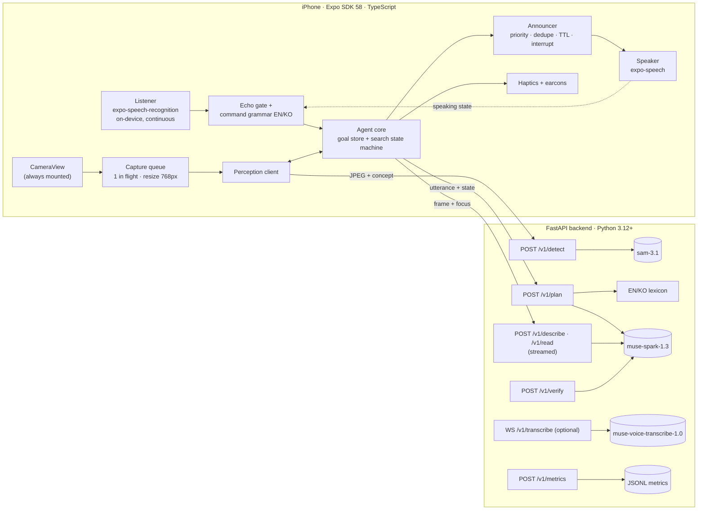
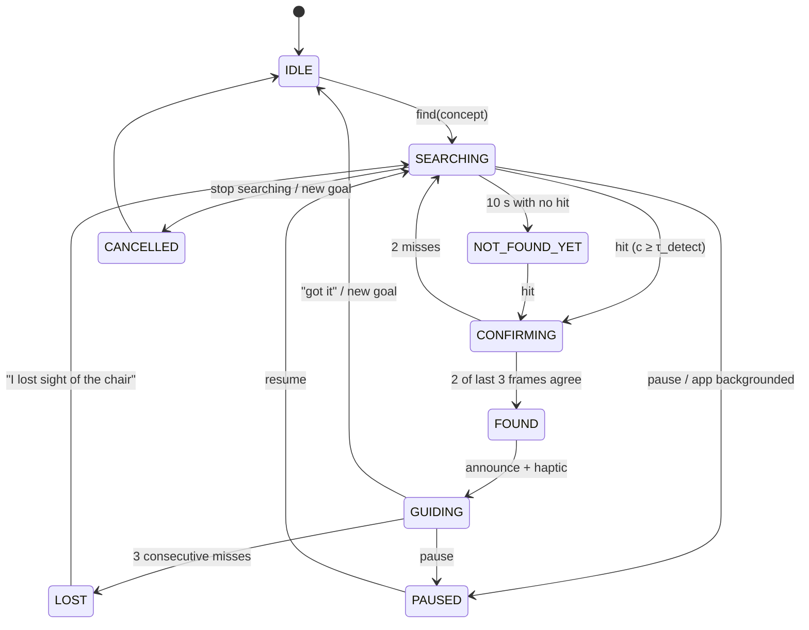

# HeyNavi — System Architecture

Status: **Planned** (2026-10-29). No code exists yet. All numbers are design targets or initial values to tune, not measurements. Facts this design depends on are sourced in [FEASIBILITY.md](FEASIBILITY.md).

## 1. Design principles

1. **Hold a goal, not a photo.** The unit of work is a user *objective* ("find a chair") that persists across many sampled frames until it is met, changed or cancelled. This is what separates HeyNavi from a "Simple Image Analyzer".
2. **Fast model on the main loop, slow model beside it.** The per-frame loop runs only on `sam-3.1`. `muse-spark-1.3` always reasons and is likely seconds to tens of seconds per call, so it plans, verifies, describes and reads off the main loop. It never gates a "found it" announcement.
3. **Never go silent.** Every user request gets spoken feedback within about 300 ms (an earcon or "Looking…"). Every failure is spoken, with a next step.
4. **Say only what the evidence supports.** Positions are given relative to the *camera view* (left / center / right). Distance is only described as "looks close" or "looks far", from box size. HeyNavi never claims a path is safe and never counts in steps or meters.
5. **Voice first, touch always available.** Voice drives everything during a session. A full-screen tap target, VoiceOver Magic Tap and Escape always work, even when speech recognition doesn't.
6. **Small and measurable.** One Expo app and one FastAPI service, no microservices. Every stage is timestamped so we can report real latency.

## 2. System overview



The Meta API key exists only in the backend environment. The app authenticates to the backend with a per-install token, and the backend rate-limits per token.

## 3. Mobile app

### 3.1 Module layout

```
apps/mobile/
  app/                      Expo Router
    _layout.tsx             providers, audio session, keep-awake
    index.tsx               Home / Voice Start (wireframe 01)
    session.tsx             unified camera session (wireframes 02–06 are modes of this screen)
    onboarding/…            voice-first onboarding + permissions (09)
    settings.tsx            voice-controllable settings (07)
    history.tsx             P5, text-only, opt-in (08)
  src/agent/                pure TypeScript, unit-tested, no React
    types.ts                SessionState, Goal, Observation, Announcement
    searchMachine.ts        reducer: (state, event) -> state + effects
    confirm.ts              multi-frame confirmation + spatial matching
    commandGrammar.ts       EN/KO regex grammar -> Command
    announcer.ts            priority queue, dedupe, TTL, rate limits
  src/perception/
    frameSource.ts          interface; ExpoCameraFrameSource | VisionCameraFrameSource
    captureQueue.ts         serialized capture + resize + upload, drops stale results
  src/voice/
    listener.ts             recognizer wrapper: restart/backoff, watchdog, language switch
    echoGate.ts             suppress self-transcription while speaking
    speaker.ts              expo-speech wrapper: stop-before-speak, lastUtterance, rate/lang
  src/feedback/             haptics (expo-haptics), earcons
  src/api/client.ts         typed backend client, timeouts, retries
  src/metrics/              per-stage timestamps -> /v1/metrics
```

`FrameSource` is an interface, so the shutter-sound fallback (VisionCamera `useFrameOutput`) can replace expo-camera capture without touching the agent.

### 3.2 Session state

```ts
type Mode = 'idle' | 'find' | 'describe' | 'read' | 'watch' | 'paused';

interface Goal {
  id: string;                 // new id per objective; responses tagged with an old id are dropped
  kind: 'find' | 'read' | 'describe';
  utterance: string;          // what the user said
  concept?: string;           // English noun phrase sent to SAM, e.g. "chair"
  attributes?: string[];      // e.g. ["empty"]; checked off the main loop by Muse Spark
  createdAt: number;
}

type SearchStatus =
  | 'IDLE' | 'SEARCHING' | 'CONFIRMING' | 'FOUND' | 'GUIDING'
  | 'LOST' | 'NOT_FOUND_YET' | 'PAUSED' | 'CANCELLED';

interface SessionState {
  mode: Mode;
  goal: Goal | null;
  search: { status: SearchStatus; window: FrameResult[]; lastSeenAt?: number; foundAt?: number };
  recent: { objects: Detection[]; sceneSummary?: string; lastText?: string };
  speech: { speaking: boolean; lastUtterance?: string; rate: number; lang: 'en-US' | 'ko-KR' };
  camera: { active: boolean; inFlight: boolean };
  lastAnnounced: Map<string, number>;   // dedupeKey -> timestamp
}
```

## 4. Active Object Search agent (signature feature)

### 4.1 Goal intake: answer immediately, refine later

1. **Command grammar (on device, under 5 ms).** It matches patterns such as `find|where is|look for <X>` and `<X> 찾아줘|<X> 어디 있어`. It then strips possessives and verbs, and maps `<X>` through a bilingual lexicon of about 60 everyday objects (의자→chair, 문→door, 컵→cup, 가방→bag, 열쇠→keys…).
2. **On a lexicon hit,** the app says "Looking for a chair. Move your phone slowly." and the SAM loop starts **at once**.
3. **On a miss, or when the request has modifiers** ("my blue water bottle", "an empty chair"), the app says "One moment" and calls `POST /v1/plan`. Muse Spark at `minimal` effort, with a strict JSON schema, returns `{intent, concept_en, attributes[], text_cue?, clarify?}`. If a lexicon concept is already running, the plan updates it in place.
4. **On an ambiguous request,** Spark returns `clarify` ("Do you mean a cup or a bottle?"), the app asks, and the goal waits for the answer.

This is the multi-step, goal-directed behavior: interpret, establish the target, observe, judge evidence, keep observing, announce, and accept changes or cancellation. A deterministic state machine runs it, and the model is only called where it adds something.

### 4.2 Search state machine



Initial parameters, all tunable in config and to be tuned with the evaluation set:

| Parameter | Initial | Meaning |
|---|---|---|
| Frame interval | max(0.8 s, round-trip time) | The next capture starts when the previous result returns. Never more than one request in flight. |
| `τ_detect` | 0.40 | Minimum SAM confidence for a candidate |
| `τ_confirm` | 0.50 | Confidence each agreeing frame must reach |
| Spatial agreement | Centers within 0.25 × frame width | Per-image SAM calls have no stable object IDs |
| Lost | 3 consecutive misses | Returns to SEARCHING; the goal persists |
| Coaching prompts | 10 s, then every 15 s, then a check-in at 60 s | "Still looking. Try turning slowly to the left." Suggestions only, never directions. |

Announcements:

- **Found:** "I found a chair, on the **left** of the camera view." Position comes from the box center in thirds (x/w < 0.33 left, > 0.67 right, otherwise center).
- **Several instances:** "I see 2 chairs. The largest is in the center."
- **Size:** box area above 25% of the frame → "it looks close"; below 3% → "it looks far away". This describes the image, not a measured distance.
- **Guiding:** haptic pulses speed up as the box nears center, and the app says "Centered" once. Speech fires only when the position bucket changes, at most once every 2.5 s.
- **Attribute goals** ("empty chair"): after SAM confirms a *chair*, the app says "I found a chair on the right. Checking if it's empty…" and calls `/v1/verify` on that frame. The result is announced when it arrives, phrased with a hedge ("It looks empty").

### 4.3 Other modes on the same camera session

Switching modes never unmounts the camera.

- **Describe** ("what's around me", "what's on my right"): Muse Spark is called with the frame, an optional focus region, and the prior summary as context, then streamed, so TTS starts on the first sentence. It is asked to stay concise and to mention only what is visible.
- **Read** ("read that sign"): Muse Spark on a 1280 px frame. Repeated text is suppressed by hashing the normalized text. "Repeat", "summarize" and "translate" reuse the last text with a fast text-only call. If text is unreadable, the app says so and suggests moving closer.
- **Watch** (automatic scene descriptions, P2/P4): every N seconds the backend computes a perceptual hash of the frame. A Spark description is requested only when the scene changed a lot *and* the rate limit allows. Descriptions too similar to the last one are dropped. Obstacle mentions ("A box is visible in the lower center of the camera view") use cautious wording and never imply safety.

## 5. Announcement engine

Every utterance goes through `announcer.ts`:

```ts
interface Announcement {
  text: string; lang: 'en-US' | 'ko-KR';
  priority: 0 | 1 | 2 | 3;     // 0 user-requested reply, 1 goal event, 2 status, 3 ambient
  dedupeKey: string;            // e.g. "found:chair:left"
  goalId?: string;              // dropped if the goal changed before it is spoken
  ttlMs: number;                // dropped if it waits longer than this in the queue
}
```

Rules:

- **Preemption.** A higher priority stops lower-priority speech (`Speech.stop()` first, because `speak()` queues). User-requested replies always win.
- **Dedupe.** The same `dedupeKey` is not spoken again within its window (found: 20 s; status: 15 s; ambient: 60 s).
- **Staleness.** Messages for an old `goalId`, or past their TTL, are dropped without being spoken.
- **Rate limits.** Ambient announcements are capped at 1 per 20 s, and nothing ambient plays during an active search.
- **Pause and repeat.** "Pause" silences ambient and status speech. "Repeat" replays `lastUtterance`.

## 6. Voice pipeline

- **Listener.** `expo-speech-recognition` runs with `continuous`, `interimResults`, `requiresOnDeviceRecognition`, `contextualStrings` (Navi, stop, repeat, find, 나비, 그만, 찾아줘…), and `iosCategory: playAndRecord + defaultToSpeaker + allowBluetooth`, mode `default`. It restarts with backoff (250 ms → 2 s) on every unplanned `end`. A volume-event heartbeat watchdog restarts it if it stalls. Switching language means stopping and starting with the new locale.
- **Echo gate.** While TTS is speaking, and for 400 ms after, the gate drops every transcript except stop/repeat keywords. It also drops a stop keyword that appears in the sentence currently being spoken, and anything that fuzzy-matches the current utterance. If it still misfires on the device, recognition pauses during TTS and barge-in falls back to tap or Magic Tap.
- **Command grammar.** Stop/repeat match on *interim* results for a fast barge-in; everything else matches on finals. The "Hey Navi" prefix is optional in the foreground app. Free-form questions need it, so bystander speech isn't treated as a question.
- **Optional Meta STT path** (after the core works): a push-to-talk free-form question streams 24 kHz PCM through a FastAPI WebSocket proxy to `muse-voice-transcribe-1.0`. This is half-duplex: pause the recognizer first and restore the audio session after.
- **VoiceOver.** On the camera screen the app speaks for itself through expo-speech, and accessibility labels stay static so VoiceOver doesn't talk over the app. `onMagicTap` toggles listening or stops speech, and `onAccessibilityEscape` cancels the current goal.

## 7. Backend API contract

All requests carry `X-HeyNavi-Token` and `X-Request-Id`. Every response includes `timings` (ms per stage) for metrics.

| Endpoint | Request | Response | Model | Timeout |
|---|---|---|---|---|
| `POST /v1/detect` | `{image_b64, concept, goal_id}` | `{detections:[{box:[x1,y1,x2,y2] (normalized), c, area, h_pos}], w, h, timings}` | `sam-3.1` (`store:false`, `include_confidence`, `one_bit`) | 4 s |
| `POST /v1/plan` | `{utterance, lang, state_summary}` | `{intent, concept_en?, attributes[], text_cue?, clarify?, source:'lexicon'\|'spark'}` | lexicon, then `muse-spark-1.3` (`minimal`, strict schema) | 25 s |
| `POST /v1/describe` | `{image_b64, focus?, detail, lang, prior?}` | SSE text stream | `muse-spark-1.3` (`minimal`/`low`) | 30 s (streamed) |
| `POST /v1/read` | `{image_b64, lang, mode:'read'\|'summarize'\|'translate'}` | SSE text stream + `{text_hash}` | `muse-spark-1.3` (`low`) | 30 s (streamed) |
| `POST /v1/verify` | `{image_b64, concept, box, attribute}` | `{holds: bool, confidence, phrase}` | `muse-spark-1.3` (`minimal`, grounding schema) | 25 s |
| `WS /v1/transcribe` | PCM 24 kHz s16le | partial/final transcripts | `muse-voice-transcribe-1.0` | per turn |
| `POST /v1/metrics` | batched stage timings | 204 | — | — |
| `GET /health` | — | `{ok, models_reachable}` | — | — |

Backend layout:

```
backend/app/
  main.py                FastAPI app, auth dependency, CORS off
  settings.py            pydantic-settings: MODEL_API_KEY, model IDs, thresholds
  meta/client.py         one shared AsyncOpenAI / httpx client, keep-alive
  meta/sam.py            request builder + box-token parser (key-based regex, masks ignored)
  meta/spark.py          plan / describe / read / verify prompts + JSON schemas
  lexicon.py             EN/KO object lexicon
  routes/…               one module per endpoint
  metrics.py             JSONL sink + p50/p95 report
backend/tests/           parser, lexicon, schema and route tests (Meta calls mocked)
backend/eval/            offline detection eval over our own labeled photo set
```

Error handling: retry once on 429/503 with jitter, honoring `Retry-After`. Never retry a 504 unchanged. Map `content_policy_violation` to a spoken "I can't analyze this view". If the backend or Meta can't be reached, the app says "I've lost my connection, I'll keep trying" and backs off.

## 8. Latency budget (targets, to be replaced by measurements)

| Stage | Target | Source |
|---|---|---|
| Capture (`takePictureAsync`, 1280×720 preset) | ≤ 400 ms | unmeasured estimate |
| Resize + JPEG encode (768 px, q 0.6) | ≤ 100 ms | unmeasured estimate |
| Upload phone → backend | ≤ 300 ms | network dependent |
| `sam-3.1` round trip | ≤ 1,000 ms | **Measured from the Mac:** median 569 ms / 95th percentile 1,332 ms at 768 px; median 357 ms / 95th percentile 712 ms at 1008 px |
| Confirmation (2 of 3 frames) | about 2 cycles | design |
| **Object in view → "found" spoken** | **≤ 4 s** | target |
| "Stop" → speech stops | ≤ 500 ms | target (interim result + `Speech.stop()`) |
| Describe/read → first spoken word | ≤ 300 ms (earcon) / content when Spark returns | **Measured:** Muse Spark at `minimal` effort, median 2.76 s for a short JSON reply on one 768 px frame |

## 9. Privacy and safety

- **Frames are never stored.** They exist only in memory on the phone and the backend. Every Responses API call sends `store:false`. History (P5) stores text only, opt-in.
- **No contributor-tier models**, because Meta may train on what is sent to them.
- **No secrets in the repo.** The Meta key lives only in backend env variables; the repo has `.env.example` only.
- **Safety copy.** A spoken and on-screen disclaimer in onboarding: HeyNavi does not replace a cane, guide dog, or mobility training. It also makes no claims of safe paths, exact distances, or guaranteed hazard detection.

## 10. Evaluation and metrics

- **Offline detection set.** About 40 photos we take ourselves during the event: 25 with a target across 5 classes, 15 without. Each is hand-labeled present/absent plus position third. `eval/run.py` reports precision, recall, false-positive rate per threshold, position accuracy, and latency p50/p95. This is reported separately from the live demo.
- **Live trials.** Scripted searches in two rooms. The app logs time-to-found, false "found" announcements, repeated announcements, and stop-to-silence latency.
- **Cost.** SAM calls × $0.0025 plus Spark token usage from the `usage` field, reported per session.
- **Accessibility.** The team completes the core tasks with VoiceOver on and the screen covered. We don't claim testing with blind users.

## 11. Environments

- **Development.** `uvicorn --host 0.0.0.0` on the Mac, with the iPhone on the same Wi-Fi.
- **Demo / judging.** A small hosted instance (choice pending: Render, Fly.io, or Modal if credits arrive), plus a pre-demo `/health` check.
- **Builds.** A dev build installed from Xcode 26.6 with a free Personal Team, rebuilt on Nov 3 because profiles expire after 7 days.
