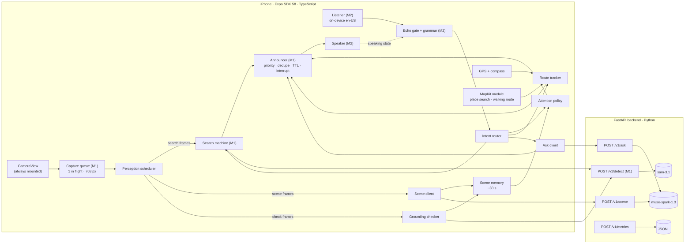

# HeyNavi — System Architecture

Status (2026-10-30): M0–M4 are implemented and tested on the iPhone 16e: the SAM 3.1 search loop, on-device English voice commands, the echo gate, Magic Tap, automatic walking-obstacle awareness (Muse Spark scene understanding, automatic SAM 3.1 checks, directional speech, overlays) and natural questions about the surroundings. Navigation is design only. Numbers are targets or initial values to tune unless they are marked as measured; the measurements are in [FEASIBILITY.md](FEASIBILITY.md).

## 1. Product and design principles

HeyNavi is a **voice-first AI environmental-awareness and navigation companion** for blind and low-vision people. The main experience is proactive and continuous:

1. The user starts HeyNavi and points the camera ahead.
2. HeyNavi interprets the scene on its own. Nobody has to name an object first.
3. It decides what is worth mentioning and says it.
4. At any time, the user can interrupt it, ask a question, or ask for a specific object.

| # | Capability | Role | Built on | Status |
|---|---|---|---|---|
| 1 | **Continuous Scene Understanding** (§4) | Primary | `muse-spark-1.3` | Implemented (M3) |
| 2 | **Grounded Object Detection** (§5) | Supporting: finds and checks the objects that scene understanding picked | `sam-3.1` | Search loop implemented (M1); automatic checks of Spark's objects implemented (M3) |
| 3 | **Proactive Voice Guidance** (§6) | Decides what is said and when, and lets the user cut it off | the app's announcer | Implemented (M1–M3) |
| 4 | **Conversational Interaction** (§7) | Natural English questions and commands. Active Object Search is one optional capability | on-device speech recognition, `muse-spark-1.3`, `sam-3.1` | Implemented (M2–M4) |
| 5 | **Destination Navigation** (§8) | A walking route from a real routing provider, plus GPS. The camera adds context | Apple MapKit, Core Location | Planned (M5, stretch) |

Principles:

1. **Spark understands, SAM verifies, the app decides.**
   - Muse Spark looks at a sampled frame plus the short-term scene memory and proposes what deserves attention.
   - SAM 3.1 then finds and checks the objects Spark named. These concepts are open-vocabulary and chosen per frame, not taken from a fixed class list.
   - Deterministic app code decides what is spoken, when, and in what words. No model output reaches the speaker without passing that code.
2. **Track what changes.** Scene memory holds what was seen and said in the last ~30 s, so HeyNavi talks about *changes* instead of narrating every frame. A goal, such as a search or a destination, lasts until it is met, changed or cancelled. This is what separates HeyNavi from a "Simple Image Analyzer".
3. **Two kinds of speech, never mixed.**
   - **Camera observations are descriptions.** They are hedged and relative to the camera view ("on the left of the camera view"). They never give distances, and they never say a way is "safe" or "clear".
   - **Route instructions come from a routing provider and GPS.** Their distances come from map data and are always rounded and prefixed with "about". They are given only while the GPS accuracy is good enough.
   - **A camera observation never confirms, overrides or merges into a route instruction.**
   - **HeyNavi never claims collision avoidance, a precise object distance, or a safe route.**
4. **The fast model gets the fast paths; the slow model works alongside them.** SAM takes about 0.6 s per call and Spark about 2.8 s (measured). Spark never delays a stop, a search's "found", or a route instruction.
5. **Quiet by default, and interruptible at all times.** Rate caps, novelty checks and dedupe keep proactive speech sparse. Stop, quiet, Magic Tap and the tap-anywhere area silence it within 500 ms (measured at 4–29 ms in M2).
6. **Voice first, touch always available.** The MVP is English-only (product decision, 2026-10-29).
7. **Small and measurable.** One Expo app and one FastAPI service. Every stage is timestamped.
8. **Build on M1/M2.** New capabilities are added next to the working code, which is reused rather than replaced. That code: the capture queue, `/v1/detect`, multi-frame confirmation, the search machine, the announcer, the voice controller, the echo gate, the command grammar, the speaker and the metrics.

## 2. System overview



- **The Meta API key lives only in the backend environment.** The app authenticates to the backend with an app token (M1).
- **Location stays on the phone.** MapKit sends coordinates and the destination query to Apple for search and routing. Our backend never receives GPS coordinates, and the metrics leave them out.

### 2.1 Perception scheduler

The capture queue (M1) keeps one capture in flight. A full search cycle took 1.1–1.5 s at the median on the iPhone 16e. Two loops share it, never at the same time:

1. **Active Object Search** (by voice). While a search goal is active, every frame goes to `/v1/detect` with the goal concept, exactly as in M1–M2. Observing pauses, so the search stays fast and quiet.
2. **Observing** (the default). A 768 px frame goes to `/v1/scene` when no call is in flight and the interval has passed: 4 s, stretching to 8 s after two replies in a row with no change. In the same request, the backend has SAM check Spark's top 3 objects on that frame, in parallel (§5.2), so the phone uploads each frame once.

Each scene frame also records how the phone was held when it was taken (§6.3).

## 3. Mobile app

### 3.1 Module layout

```
apps/mobile/src/
  app/            Expo Router screens: index (home), session (camera session), diagnostics    [M0–M3]
  agent/          pure TS, unit-tested: types, search-machine, confirm, announcer, phrases     [M1–M2]
  scene/          pure TS: scene-memory, attention-policy, scene-phrases, wording-filter        [M3]
  grounding/      grounding checker (reuses agent/confirm)                                      [M4]
  conversation/   intent router, ask client                                                     [M4]
  navigation/     pure TS route tracker, geo math, route phrases                                [M5]
  perception/     capture.ts (capture queue) [M1]; scheduler.ts [M3]
  session/        camera-session hook (search + scene on one announcer), metrics, overlays,
                  search strip, session status and last-said caption                           [M1–M3]
  voice/          voice controller, echo gate, command grammar, speaker, speech tracker         [M2]
  api/            typed backend client                                                          [M1]
  feedback/       haptics [M1]; earcons [M3]
apps/mobile/modules/heynavi-maps/   local Expo module (Swift): MKLocalSearch, MKDirections walking   [M5]
```

Changes to existing modules:

- The grammar gains the commands in §7.1.
- The announcer gains a `channel` field and per-category rate caps.
- The session hook becomes a session controller that hosts the scene, search and route tracks side by side.

### 3.2 Session state (design)

```ts
type Activity = 'explore' | 'search' | 'navigate';   // 'explore' is where every session starts

interface SessionState {
  activity: Activity;          // search and navigate are goals on top of explore
  updatesPaused: boolean;      // proactive camera lines only; replies and route lines still play
  verbosity: 'quiet' | 'normal' | 'detailed';
  scene: SceneMemory;          // §4.3
  search: SearchState | null;  // the M1 search machine, unchanged
  route: RouteState | null;    // §8
}
```

The scene track pauses during a search and keeps running during navigation, where it adds supplementary context.

### 3.3 Session screen: camera first (decided 2026-10-30)

HeyNavi is not an object picker. The camera session has no list of objects to choose from and no detection dashboard. The core loop is: open HeyNavi → the camera observes → the AI understands → HeyNavi speaks on its own → the user answers by voice.

Top to bottom:

1. **Camera preview** (9:16, the largest element). A tap anywhere on it does the same as Magic Tap. While a search runs, SAM's box for the target is drawn on it; a small latency readout (SAM or Spark) sits in a corner for the demo.
2. **Status.** While observing: a chip ("Observing", "Observing paused", "Starting the camera") and the update level. While a search runs: the search strip (target, state, 3-dot confirmation).
3. **Last said.** The line HeyNavi is speaking or last spoke, as text, for low-vision users and sighted helpers.
4. **Mic status**, with its on/off control (M2).
5. **One primary button**: "Pause observing" / "Resume observing", or "End search" while a search runs.
6. **One secondary button**: "Describe the view" (the touch version of "What's around me").

Everything else is voice: "What's around me", "Find a chair", "Where is the entrance", "quieter", "more detail", "pause", "resume", "repeat", "cancel". Active Object Search keeps its engine (M1–M2) and is started only by voice; the target is whatever noun phrase the user says. Magic Tap: silence speech, else end a search, else pause or resume observing. The VoiceOver escape gesture ends a search and goes back.

Labels and hints are read aloud by VoiceOver and heard by the microphone, so none is a voice command, none starts with "stop", and none contains the wake word (unit-tested). A route card for navigation (M5) will join the status area only while a route is active.

## 4. Continuous Scene Understanding (primary)

### 4.1 Loop

- **One Spark call in flight at a time.** The next scene frame is taken at least 4 s after the previous one. Muse Spark at `minimal` effort took a median 2.8 s for a short JSON reply on one 768 px frame (G4). The richer scene reply has not been measured yet; that is the first task of M3.
- **Adaptive cadence.** After two replies in a row with `change: "none"`, the interval grows to 8 s. A change, a user request or a new activity resets it to 4 s.
- **Request.** A 768 px JPEG (the same capture as search), plus compact context of at most ~600 characters:
  - the last summary;
  - the items in memory, each with its age, position and whether it was spoken;
  - the activity (and, while navigating, the text of the next route instruction);
  - the verbosity.

### 4.2 What Spark returns (strict JSON schema)

Spark is asked about **walking relevance, not interest** (decided 2026-10-30 after round 3): what could get in the way of someone walking the way the camera points, judged from the scene rather than a fixed list. Pictures, screens and things on desks, tables or shelves are left out unless they stick out into the walking area.

```jsonc
{
  "summary": "A hallway with boxes along the left wall.",  // ≤ 15 words, walking-relevant things only
  "change": "none | minor | major",                        // compared with the context sent
  "items": [                                               // at most 4, most relevant to walking first
    {
      "label": "bag",                // plain singular name, no place ("bag", not "bag on floor")
      "count": 1,                    // 1 for things that are not counted, like clothing
      "kind": "possible_obstacle | level_change | overhead | person | landmark | text | object",
      "position": "left | center | right",  // in the camera view
      "band": "lower | middle | upper",
      "status": "new | still | moved | gone",
      "importance": "high | medium | low",   // walking relevance: in the path / off to the side / none
      "ground": "bag",               // concept for SAM to check, or ""
      "text": ""                     // verbatim text, only when kind is "text"
    }
  ]
}
```

`level_change` covers stairs, steps, curbs, ramps and drop-offs; `overhead` covers low-hanging or protruding things at head or body height; `landmark` covers doors, doorways, entrances and elevators.

**The prompt rules:**
- describe only what is visible;
- no distances;
- no safety judgments;
- no instructions to move;
- positions relative to the camera view;
- use the context to set each item's `status`.

**The backend:**
- validates labels with the same pattern as search concepts, and cuts a place out of a label ("clothing on floor" → "clothing");
- caps the length of text fields;
- runs the wording filter (§6.3) on all free text.

Anything invalid is dropped and logged, never spoken.

### 4.3 Scene memory (pure TS, on device)

- **Items are keyed** by normalized label (using the grammar's stemming) and coarse position. A new report of the same item updates the existing entry instead of adding one.
- **Each item stores:**
  - its label, kind, position and band;
  - when it was first seen, last seen and last spoken;
  - its check state (`unchecked`, `pending`, `verified` or `rejected`, from §5.2);
  - the SAM box, if there is one.
- **Items expire** after 30 s unseen, or as soon as Spark reports them `gone`.
- **The memory also keeps the last 3 summaries.** This history is what lets HeyNavi detect changes, and it keeps the prompt small.

### 4.4 What deserves attention

The attention policy (`scene/attention-policy.ts`) is pure TypeScript, deterministic and unit-tested. The default mode announces **potential walking obstacles**, not every interesting object. An item is said proactively only when it is walking-relevant: a walking kind (`possible_obstacle`, `level_change`, `overhead`, `person`, `landmark`) with `importance` above `low`. Plain objects are never proactive; signs only at "detailed".

| What SAM found | Line | Priority |
|---|---|---|
| Confirmed level change | "Steps are visible ahead." | 1 |
| Confirmed possible obstacle in the walking area (`high`, not upper band), or overhead thing | "Possible obstacle: a chair ahead on your left." | 1 |
| Confirmed thing off to the side, or a person | "A bag is visible on the floor ahead on your right." "A person is visible ahead on your right." | 2 (doors 3) |
| Not localized by SAM (not found, or not checked), but Spark puts a hazard or person in the walking area (`high`) | "There may be a bag on the floor ahead." (hedged, no box) | 2 |
| Not localized and not in the walking area; decor; things on desks | nothing | — |

- **A SAM miss is not proof of absence.** It only changes the wording from plain to hedged, and removes the box.
- **First look**: the summary once, when observing starts. **Major change** (a new room): the summary, plus an in-path item it leaves out.
- **Repetition**: one line per reply with at most two things ("Possible obstacles: 2 baskets directly ahead, and 5 shoes directly ahead."). A thing is not said again within its window (60 s; 120 s for low relevance and text), remembered for 2 minutes even after scene memory forgets it.
- **Rate caps**: at least 6 s between lines (3 s before a confirmed hazard) and at most 6 per minute. A priority-1 line may cut off a priority-2 or 3 line that is playing.
- **Verbosity**: "quieter" keeps only `high` items; "more detail" adds signs.
- **Never**: "clear", "safe", distances, collision predictions or walking directions. When only irrelevant things are in view, HeyNavi says nothing.

## 5. Grounded Object Detection (supporting)

### 5.1 Active Object Search (implemented, M1–M2)

The user names an object ("Hey Navi, find a chair"), and every frame goes to SAM 3.1 with that concept. Confirmation is spatial, 2 of the last 3 frames, because per-image SAM calls have no stable object IDs. Implemented states:

- SEARCHING, CONFIRMING, FOUND, GUIDING, LOST, PAUSED, CANCELLED;
- coaching prompts and a check-in;
- outage handling.

Measured on the iPhone 16e: 6 of 6 searches found the chair, a 40 s run with no chair gave 0 false "found", and the chair was announced about 2.5–3 s after it came into view. In the new vision this is one optional capability, started by a command or by a question (§7.2).

| Parameter | Value | Meaning |
|---|---|---|
| Frame interval | the next capture starts when the previous result returns | never more than one request in flight |
| `τ_detect` / `τ_confirm` | 0.40 / 0.50 | minimum SAM confidence for a candidate / for an agreeing frame |
| Spatial agreement | box centers within 0.25 × frame width | matches the same object across frames |
| Lost | 3 consecutive misses | back to searching; the goal is kept |

### 5.2 Automatic multi-object checks (M3)

Every scene request asks for `ground: 3`. After Spark replies, the backend picks up to 3 of its items with a `ground` concept (not text, not "gone"), most important first (possible obstacles, then landmarks and people, then other objects), and runs one SAM 3.1 call per distinct concept on **the same frame Spark saw**, in parallel. Each item comes back with:

- `grounded`: `true` when SAM's best box has confidence ≥ 0.5, `false` when SAM found nothing that good, `null` when it was not checked (beyond the top 3, or the SAM call failed: a failure never fails the reply);
- `detections`: up to 3 SAM boxes with confidence ≥ 0.4, best first.

Rules in the app:

- **Only confirmed things are mentioned proactively.** A physical item is spoken only after SAM found it. Text needs no SAM; an item with no concept only when Spark rates it high. "What's around me" may also mention unchecked items, but never one SAM looked for and did not find.
- **Positions come from SAM's box**, not from Spark's thirds: the box center's horizontal third gives left / center / right, its vertical third the band.
- **"Possible obstacle" only after SAM confirms it**, and only in the lower or middle of the view.
- **Every confirmed item gets a blue box on the preview** while observing (a thicker one, with a red tag, for a possible obstacle). This is for debugging and the demo; voice stays the interface.
- **Size wording comes from the box, never from distance.** "It looks close" (box over 25% of the frame) is used only by the search.
- **Spending is bounded**: at most 3 SAM calls per scene frame ($0.0075).

A fresh-frame re-check ("is it still in view?") and tracking objects between Spark calls are future work (§15).

## 6. Proactive Voice Guidance

### 6.1 Announcer (implemented, extended)

Every utterance goes through `agent/announcer.ts`:

- one utterance at a time;
- priority preemption (`Speech.stop()` first);
- a dedupe key and window;
- a TTL;
- stale-goal dropping;
- repeat.

The extensions:

```ts
interface Announcement {
  text: string; lang: 'en-US';
  priority: 0 | 1 | 2 | 3;   // 0 reply to the user, 1 possible obstacle / found / imminent route step, 2 notable, 3 background
  channel: 'reply' | 'camera' | 'route' | 'status';
  key: string; dedupeMs: number; ttlMs: number; goalId: string | null;
}
```

- **Camera lines** have a short TTL (3–4 s), because the scene moves on. A late observation is dropped, not spoken.
- **Route lines** last until their trigger point has passed. They start with a short chime earcon and the word "Route", so they can't be confused with camera lines.
- **Per-channel rate caps** apply to proactive camera lines only.

### 6.2 Interrupting and controlling it

| Input | While speaking | While silent |
|---|---|---|
| "stop" / Magic Tap / tap anywhere | Silences the current line (M2 barge-in, 4–29 ms) | During a search: ends the search (M2). Otherwise: pauses proactive updates ("Updates paused. Say resume to continue.") |
| "quiet" | Silences the current line | — |
| "pause" / "resume" | Pauses or resumes the search, or proactive updates | same |
| "fewer updates" / "more updates" | Steps verbosity (quiet ↔ normal ↔ detailed) | same |
| "repeat" | Repeats the last line (M2) | same |
| "cancel" / "stop searching" / "stop navigation" | Ends that goal | same |

A reply to the user (priority 0) always wins. Pausing updates never silences route instructions; only "stop navigation" does.

### 6.3 Wording rules, enforced in code

- **Directions are approximate and never distances.** How they are worded depends on how the phone was held when the frame was taken, from the device-motion gravity vector (`perception/orientation.ts`):
  - **Held forward** (upright in portrait, camera between 25° above and 55° below level, not turned sideways): the camera's left is the user's left. "There's a chair ahead on your left." "Possible obstacle: a box directly ahead." "There are stairs ahead on your right."
  - **Anything else, or no sensor**: relative to the camera view. "There's a chair on the left of the camera view." "Possible obstacle: a box in the lower center of the camera view."

  HeyNavi never assumes the camera points where the user is walking, and never says which way is safe to go.
- **Proactive camera lines come from templates filled with structured fields**, not from Spark's free text. One line holds at most two things: "Possible obstacle: a box directly ahead. There's a chair ahead on your left."
- **A summary or an answer goes through the wording filter** in the backend and again in the app. The filter rejects text containing any of these:
  - distance or units (meter, feet, yards, inches, counted steps, and numbers next to them);
  - safety or permission claims (safe, clear path, all clear, no obstacles, nothing in your way, you can walk/go/cross, go ahead);
  - movement directions ("walk", "turn", "step") at the start of a sentence;
  - claims about traffic signals ("the light is green").

  A rejected summary is replaced by a template built from the items, or skipped. A rejected answer is replaced by "I can't answer that from the camera view."
- **No line or clause may be a voice command or contain the wake word** (unit-tested over every template and label).
- **Route lines come only from the route tracker (§8).**

## 7. Conversational Interaction

### 7.1 Commands (on-device grammar)

| Command | Status |
|---|---|
| "find / search / look for / where is X" → Active Object Search | Implemented (M2) |
| stop, cancel, stop searching, quiet, pause, resume, repeat, help | Implemented (M2) |
| "what's around me", "describe", "what's in front of me" → an immediate scene reply at detailed verbosity, outside the cadence | Implemented (M3) |
| "quieter" / "fewer updates", "more detail" / "more updates", "updates off", "updates on" | Implemented (M3) |
| "where is the entrance" and other free-form targets → Active Object Search on that noun phrase | Implemented (M2 grammar, voice only since M3) |
| Questions: "where is the entrance", "what objects are nearby", "is there a chair here" (§7.2) | Implemented (M4) |
| "navigate to X", "take me to X", "where am I", "what's next", "stop navigation" | Planned (M6) |

### 7.2 Free-form questions (implemented, M4)

- **What counts as a question.** A final transcript that no fixed command matches and that starts like a question: "what …", "where is …", "is there …", "are there …", "can you see …", "how many …", "which …", with at least one word that says what it is about ("where is the" is not a question yet). Fixed commands win: "what's in front of me" stays describe, "what can you do" stays help. No wake phrase is needed.
- **What happens.** "Let me look." plays at once. The app takes one 640 px frame and sends it to `/v1/ask` with the question, the scene memory and how the phone is held. Muse Spark returns `{answer, about, search}`: a one- or two-sentence answer in the same kind of directions as the camera lines, the one thing the question is about (label, SAM concept, visible, position), and whether to keep looking for it.
- **SAM checks the answer.** When the thing is visible, SAM looks for it on the same frame. Its box is outlined, and when SAM places it in a different third than Spark said, HeyNavi says SAM's position instead ("An entrance is visible ahead on your right.").
- **Search hand-off.** Only a "where …" question whose thing is not in view starts the Active Object Search for it ("I don't see an entrance right now." → searching for a door). A general question never does: a misheard "what objects are nearby" once started a search for a projector.
- **Safety.** The answer goes through the wording filter in the backend and in the app. If it fails, HeyNavi says "I can't answer that from the camera view."
- **Over HeyNavi's speech.** Questions are accepted while HeyNavi talks, and picked out of its echo when said just before or after its words, but not if they repeat a content word HeyNavi just said.
- **Limitations.** Without a wake phrase, a question asked by someone nearby is answered too. Misrecognitions become wrong questions ("where is the door" heard as "where is the war").

## 8. Destination Navigation (M6, stretch)

- **Provider: Apple MapKit on the phone**, through a local Expo module (Swift, about 150 lines):
  - `MKLocalSearch` resolves a destination by name or category, and the app sorts the results by distance.
  - `MKDirections` with `transportType = .walking` returns the route line and the steps.
  - It needs no API key, no account and no paid Apple membership.
  - **Measured from the Mac on 2026-10-29:** Seoul City Hall → Gwanghwamun took 320 ms and returned 756 m in 6 steps with English instructions; place search took 200–320 ms. See [research/routing.md](research/routing.md).
  - Apple's walking data in Korea is reported to be uneven, so we walk the demo route ourselves first.
- **Fallbacks:**
  - The OSRM foot profile, called from the backend, also needs no key. The public server is for light use only.
  - TMAP's pedestrian API, if the user creates an SK Open API key.
- **Location:** `expo-location`, with position updates every 1 s at navigation accuracy plus compass heading.
- **The route tracker is pure TypeScript and unit-tested.** It:
  - snaps the position to the route line;
  - measures the distance along the route to the next step;
  - re-requests the route when the user is more than 25 m from it for more than 10 s ("You may be off the route. Recalculating.");
  - announces arrival within 15 m ("You're near the destination, according to the map").
- **When route lines are spoken:**
  - at the start (total distance, number of turns, first instruction);
  - about 30 m before each step and again at the step;
  - on request ("what's next").

  For example: "Route: in about 40 meters, turn right onto Sejong-daero."
- **GPS check.** Instructions are given only when the reported horizontal accuracy is 20 m or better. Otherwise HeyNavi says "The GPS signal is weak, so I can't place you on the route right now." Distances are rounded to 10 m and always prefixed with "about".
- **The camera stays on as supplementary context.** The scene track keeps running, and Spark receives the next instruction as text, so it can mention something relevant like a visible crosswalk. Camera lines keep their own wording and are never merged into route lines. HeyNavi never says it is safe to cross or to walk, and never reports traffic-signal state.
- **Outdoor prerequisites, needed for any outdoor test:**
  - a release build with the JavaScript bundled in, because Metro isn't reachable over cellular;
  - a backend the phone can reach over cellular (hosted, or a tunnel from the Mac);
  - metrics uploaded to `/v1/metrics`, because Metro's log isn't available outdoors.

## 9. Voice pipeline (implemented, M2)

- **Listener.** `expo-speech-recognition` with these settings:
  - `continuous`, `interimResults` and `requiresOnDeviceRecognition`;
  - `contextualStrings`;
  - `lang: en-US`;
  - `iosCategory: playAndRecord + defaultToSpeaker + allowBluetooth`.

  It restarts with backoff after an unplanned end, and a stall watchdog restarts it if it hangs. On-device en-US recognition was verified in Airplane Mode (G6).
- **Echo gate.** While HeyNavi speaks, and for 400 ms after, transcripts that match its own words (stem overlap ≥ 60%) are dropped. A barge-in command said before or after the echoed words still counts. During speech, interim results can only *quiet*; a "stop" in silence ends the search. Since M3, requests about the speech or the updates ("what's around me", "quieter", "more detail", "pause", "resume", "repeat") are also accepted over speech and picked out of a transcript glued to the echo; a search request still needs a pause or the wake phrase.
- **Speaker.** expo-speech uses the same audio category as the recognizer. Re-applying that category is skipped once it has been seen to match, because the call blocked the JS thread for about 500 ms on the device.
- **VoiceOver.** Magic Tap works through the React Native patch (M2). The mic also hears VoiceOver, so spoken labels avoid command words, which a unit test checks.

## 10. Backend API contract

All requests except plain `/health` carry `X-HeyNavi-Token`. Every model response includes per-stage timings in ms, and the Spark routes also include token `usage`.

| Endpoint | Request | Response | Model | Timeout | Status |
|---|---|---|---|---|---|
| `POST /v1/detect` | `{image_b64, concept, goal_id, frame_id}` | `{goal_id, frame_id, concept, image, detections:[{box, confidence, center_x, area, position}], timings_ms}` | `sam-3.1` (`store:false`) | 4 s | Implemented (M1) |
| `POST /v1/scene` | `{image_b64, session_id, frame_id, context, detailed, ground}` | §4.2 JSON; each item also `grounded` and SAM `detections` (§5.2); `timings_ms` (spark, sam), `usage` (tokens, SAM images, cost) | `muse-spark-1.3` (`minimal`, strict schema) + up to 4 parallel `sam-3.1` | 12 s + 4 s | Implemented (M3) |
| `POST /v1/ask` | `{image_b64, session_id, question, context, hold}` | `{answer, about: {label, ground, visible, position, band, grounded, detections}, search, timings_ms, usage}` | `muse-spark-1.3` (`minimal`, strict schema) + one `sam-3.1` check | 12 s + 4 s | Implemented (M4) |
| `POST /v1/metrics` | `{session_id, lines}` (metric lines only; no coordinates) | 204 | — | — | Implemented (M3); the app uploader comes with the release build (M5) |
| `GET /health` (`?deep=true` needs the token) | — | `{ok, service, version, key_configured}`; deep adds `models_reachable`, `sam_available`, `spark_available` | — | — | Implemented (M0) |

- **Dropped from the earlier design:** `/v1/plan`, `/v1/verify`, `/v1/describe` and `/v1/read`. Their jobs fold into `/v1/scene` and `/v1/ask`. `WS /v1/transcribe` moves to future work.
- **Spending guard (M3).** The backend counts SAM images and Spark tokens per day. Past `DAILY_BUDGET_USD` (default $25) it answers with a 503 `budget_exhausted`, so a runaway loop can't drain the credits. The app says "I've paused updates to save credits."
- **Errors.** As in M1: no retry on the per-frame path, and `Retry-After` honored. A `content_policy_violation` is spoken as "I can't analyze this view." Losing the backend is spoken once, and the app backs off.

## 11. Latency budget

| Stage | Target | Measured |
|---|---|---|
| Search frame cycle (capture → SAM → result) | ≤ 1.5 s | median 1.13–1.48 s (M1) |
| Object in view → "found" spoken | ≤ 4 s | about 2.5–3 s (M1) |
| Scene frame captured → proactive line starts | p50 ≤ 5 s, p95 ≤ 7 s | **4.95 s / 7.5 s** (M4 round 1, 32 looks: 640 px frames, 3 items, SAM checks capped at 1.5 s; Spark p50 3.2 s / p95 5.1 s). M3 final: 5.7 s / 6.8 s. p50 met; p95 over by ~0.5 s, from occasional long Spark replies |
| Possible obstacle (Spark + both SAM checks) → spoken | p50 ≤ 6 s | not measured |
| Question → "Let me look." / answer ready | ≤ 300 ms / ≤ 5 s | answer ready 1.7–3.1 s after its frame (5 questions, M4 round 1) |
| Stop → silence | ≤ 500 ms | 4–29 ms (M2) |
| Route step trigger → spoken | ≤ 2 s (GPS at 1 Hz) | not measured |

Proactive camera lines describe what was in view a few seconds earlier. That is one more reason they are descriptions and never safety guidance.

## 12. Privacy and safety

- **Frames are never stored.** They exist only in memory on the phone and the backend, and every Responses API call sends `store:false`.
- **Location:** see §2.
- **No contributor-tier models**, because Meta may train on what is sent to them.
- **No secrets in the repo.** The Meta key lives only in `backend/.env`.
- **Safety copy.** A spoken and on-screen disclaimer in onboarding:
  - HeyNavi does not replace a cane, a guide dog, or orientation-and-mobility training.
  - It does not detect every obstacle and cannot tell whether it is safe to walk or cross.
  - Route guidance comes from map data and GPS, which can be off by tens of meters.

## 13. Evaluation and metrics

- **Scene walks (M3–M4).** For each scripted indoor walk we log:
  - proactive lines per minute;
  - repeats inside the dedupe window (target 0);
  - wording-filter hits that would have been spoken (target 0);
  - frame-to-speech latency, p50 and p95;
  - the Spark/SAM agreement rate;
  - the tester's judgment of each line: correct, partly correct or wrong.

  This is a small honest sample, not a benchmark.
- **Searches.** The M1–M2 live trials: time to found, false "found" announcements, stop latency.
- **Questions.** 10 scripted questions, with latency and the tester's judgment.
- **Navigation.** Logs from the walk: GPS accuracy, every step announced, re-routes.
- **Cost.** Per active minute, from `usage` and the SAM image count.
- **Accessibility.** The team completes the core tasks with VoiceOver on and the screen covered. We don't claim testing with blind users.

## 14. Environments

- **Development.** `uvicorn --host 0.0.0.0` on the Mac, with the iPhone on the same Wi-Fi and Metro serving the dev build.
- **Outdoors and demo.** A release build, plus a backend reachable over cellular: a small hosted instance (Render or Fly.io) or a Cloudflare quick tunnel from the Mac. The choice is made in M5.
- **Builds.** `apps/mobile/scripts/build-ios-device.sh` with a free Personal Team. The profile expires 2026-11-05 11:10 PST, so rebuild before the Nov 9 live final.

## 15. Future enhancements

- **Multilingual support.** The hackathon MVP is English-only (product decision, 2026-10-29). Adding a language means:
  - a phrase table;
  - a command grammar;
  - a lexicon that maps to English SAM concepts;
  - an on-device recognition test for that locale.

  Korean is the first candidate. Muse Voice Transcribe supports 25 languages with code-switching, which is an option where Apple has no on-device recognizer.
- **Questions through Muse Voice Transcribe**, as push-to-talk.
- **Haptic route cues, and Korean pedestrian data** (TMAP).
- **Tracking verified objects between Spark calls**, so HeyNavi can say "the chair is now on your left" at SAM speed.
- **Open-weight models**, for the open-weight bonus.
