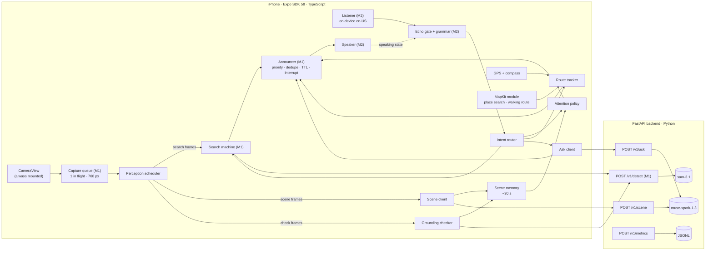

# HeyNavi — System Architecture

Status (2026-10-29): M0–M2 are implemented and tested on the iPhone 16e. That covers the SAM 3.1 search loop, on-device English voice commands, the echo gate and Magic Tap. The product vision was revised on 2026-10-29 (§1). Continuous scene understanding, grounded verification, questions and navigation are design only. Numbers are targets or initial values to tune unless they are marked as measured; the measurements are in [FEASIBILITY.md](FEASIBILITY.md).

## 1. Product and design principles

HeyNavi is a **voice-first AI environmental-awareness and navigation companion** for blind and low-vision people. The main experience is proactive and continuous:

1. The user starts HeyNavi and points the camera ahead.
2. HeyNavi interprets the scene on its own. Nobody has to name an object first.
3. It decides what is worth mentioning and says it.
4. At any time, the user can interrupt it, ask a question, or ask for a specific object.

| # | Capability | Role | Built on | Status |
|---|---|---|---|---|
| 1 | **Continuous Scene Understanding** (§4) | Primary | `muse-spark-1.3` | Planned (M3) |
| 2 | **Grounded Object Detection** (§5) | Supporting: finds and checks the objects that scene understanding picked | `sam-3.1` | Search loop implemented (M1); checking scene items planned (M4) |
| 3 | **Proactive Voice Guidance** (§6) | Decides what is said and when, and lets the user cut it off | the app's announcer | Announcer implemented (M1–M2); attention policy planned (M3) |
| 4 | **Conversational Interaction** (§7) | Natural English questions and commands. Active Object Search is one optional capability | on-device speech recognition, `muse-spark-1.3`, `sam-3.1` | Commands and search implemented (M2); questions planned (M4) |
| 5 | **Destination Navigation** (§8) | A walking route from a real routing provider, plus GPS. The camera adds context | Apple MapKit, Core Location | Planned (M5, stretch) |

Principles:

1. **Spark understands, SAM verifies, the app decides.**
   - Muse Spark looks at a sampled frame plus the short-term scene memory and proposes what deserves attention.
   - SAM 3.1 then finds and checks the objects Spark named. These concepts are open-vocabulary and chosen per frame, not taken from a fixed class list.
   - Deterministic app code decides what is spoken, when, and in what words. No model output reaches the speaker without passing that code.
2. **Track what changes.** Scene memory holds what was seen and said in the last ~30 s, so HeyNavi talks about *changes* instead of narrating every frame. A goal, such as a search or a destination, lasts until it is met, changed or cancelled. This is what separates HeyNavi from a "Simple Image Analyzer".
3. **Two kinds of speech, never mixed.**
   - **Camera observations are descriptions.** They are hedged and relative to the camera view ("on the left of the camera view"). They never give distances, and they never say a way is "safe" or "clear".
   - **Route instructions come from a routing provider and GPS.** Their distances come from map data and are always rounded and prefixed with "about". They are given only while the GPS accuracy is good enough.
   - **A camera observation never confirms, overrides or merges into a route instruction.**
   - **HeyNavi never claims collision avoidance, a precise object distance, or a safe route.**
4. **The fast model gets the fast paths; the slow model works alongside them.** SAM takes about 0.6 s per call and Spark about 2.8 s (measured). Spark never delays a stop, a search's "found", or a route instruction.
5. **Quiet by default, and interruptible at all times.** Rate caps, novelty checks and dedupe keep proactive speech sparse. Stop, quiet, Magic Tap and the tap-anywhere area silence it within 500 ms (measured at 4–29 ms in M2).
6. **Voice first, touch always available.** The MVP is English-only (product decision, 2026-10-29).
7. **Small and measurable.** One Expo app and one FastAPI service. Every stage is timestamped.
8. **Build on M1/M2.** New capabilities are added next to the working code, which is reused rather than replaced. That code: the capture queue, `/v1/detect`, multi-frame confirmation, the search machine, the announcer, the voice controller, the echo gate, the command grammar, the speaker and the metrics.

## 2. System overview



- **The Meta API key lives only in the backend environment.** The app authenticates to the backend with an app token (M1).
- **Location stays on the phone.** MapKit sends coordinates and the destination query to Apple for search and routing. Our backend never receives GPS coordinates, and the metrics leave them out.

### 2.1 Perception scheduler

The capture queue (M1) keeps one capture in flight. A full cycle took 1.1–1.5 s at the median on the iPhone 16e. The scheduler sends each frame to at most one track, in this order:

1. **Active Object Search.** While a search goal is active, every frame goes to SAM with the goal concept, exactly as in M1–M2. The scene track pauses, so the search stays as fast and quiet as it is today.
2. **Scene.** When no Spark call is in flight and the scene interval has passed, the frame goes to `/v1/scene`. The interval starts at 4 s and stretches to 8 s after two replies in a row with no meaningful change.
3. **Grounding.** When scene memory has items waiting to be checked, the frame goes to `/v1/detect` with that item's concept. At most 2 items wait at a time, taken in turn.
4. **Nothing.** Otherwise no frame is captured, which saves battery and credits.

## 3. Mobile app

### 3.1 Module layout

```
apps/mobile/src/
  app/            Expo Router screens: index (home), session (camera session), diagnostics    [M0–M2]
  agent/          pure TS, unit-tested: types, search-machine, confirm, announcer, phrases     [M1–M2]
  scene/          pure TS: scene-memory, attention-policy, scene-phrases, wording-filter        [M3]
  grounding/      grounding checker (reuses agent/confirm)                                      [M4]
  conversation/   intent router, ask client                                                     [M4]
  navigation/     pure TS route tracker, geo math, route phrases                                [M5]
  perception/     capture.ts (capture queue) [M1]; scheduler.ts [M3]
  session/        session hook and controllers, metrics, overlays, state strip                  [M1–M2]
  voice/          voice controller, echo gate, command grammar, speaker, speech tracker         [M2]
  api/            typed backend client                                                          [M1]
  feedback/       haptics [M1]; earcons [M3]
apps/mobile/modules/heynavi-maps/   local Expo module (Swift): MKLocalSearch, MKDirections walking   [M5]
```

Changes to existing modules:

- The grammar gains the commands in §7.1.
- The announcer gains a `channel` field and per-category rate caps.
- The session hook becomes a session controller that hosts the scene, search and route tracks side by side.

### 3.2 Session state (design)

```ts
type Activity = 'explore' | 'search' | 'navigate';   // 'explore' is where every session starts

interface SessionState {
  activity: Activity;          // search and navigate are goals on top of explore
  updatesPaused: boolean;      // proactive camera lines only; replies and route lines still play
  verbosity: 'quiet' | 'normal' | 'detailed';
  scene: SceneMemory;          // §4.3
  search: SearchState | null;  // the M1 search machine, unchanged
  route: RouteState | null;    // §8
}
```

The scene track pauses during a search and keeps running during navigation, where it adds supplementary context.

## 4. Continuous Scene Understanding (primary)

### 4.1 Loop

- **One Spark call in flight at a time.** The next scene frame is taken at least 4 s after the previous one. Muse Spark at `minimal` effort took a median 2.8 s for a short JSON reply on one 768 px frame (G4). The richer scene reply has not been measured yet; that is the first task of M3.
- **Adaptive cadence.** After two replies in a row with `change: "none"`, the interval grows to 8 s. A change, a user request or a new activity resets it to 4 s.
- **Request.** A 768 px JPEG (the same capture as search), plus compact context of at most ~600 characters:
  - the last summary;
  - the items in memory, each with its age, position and whether it was spoken;
  - the activity (and, while navigating, the text of the next route instruction);
  - the verbosity.

### 4.2 What Spark returns (strict JSON schema)

```jsonc
{
  "summary": "A hallway with a door on the right.",   // ≤ 20 words, neutral, visible things only
  "change": "none | minor | major",                   // compared with the context sent
  "items": [                                          // at most 5
    {
      "label": "open door",          // short English noun phrase
      "kind": "object | possible_obstacle | person | text | landmark",
      "position": "left | center | right",           // in the camera view
      "band": "lower | middle | upper",
      "status": "new | still | moved | gone",
      "importance": 1,               // 1 worth interrupting for, 2 notable, 3 background
      "ground": "door",              // concept for SAM to check, or null
      "text": null                   // verbatim text, only when kind is "text"
    }
  ]
}
```

**The prompt rules:**
- describe only what is visible;
- no distances;
- no safety judgments;
- no instructions to move;
- positions relative to the camera view;
- use the context to set each item's `status`.

**The backend:**
- validates labels with the same pattern as search concepts;
- caps the length of text fields;
- runs the wording filter (§6.3) on all free text.

Anything invalid is dropped and logged, never spoken.

### 4.3 Scene memory (pure TS, on device)

- **Items are keyed** by normalized label (using the grammar's stemming) and coarse position. A new report of the same item updates the existing entry instead of adding one.
- **Each item stores:**
  - its label, kind, position and band;
  - when it was first seen, last seen and last spoken;
  - its check state (`unchecked`, `pending`, `verified` or `rejected`, from §5.2);
  - the SAM box, if there is one.
- **Items expire** after 30 s unseen, or as soon as Spark reports them `gone`.
- **The memory also keeps the last 3 summaries.** This history is what lets HeyNavi detect changes, and it keeps the prompt small.

### 4.4 What deserves attention

The attention policy is pure TypeScript, deterministic and unit-tested. It turns changes in memory into candidate announcements:

| Candidate | Condition | Priority | Dedupe window | Spoken at verbosity |
|---|---|---|---|---|
| Possible obstacle | `kind: possible_obstacle`, `band` lower or middle, confirmed by SAM (§5.2) | 1 | 30 s per label and position | quiet, normal, detailed |
| New notable item | `status: new`, `importance` 1–2, confirmed by SAM when it has a `ground` concept | 2 | 60 s per label | normal, detailed |
| Major scene change | `change: major` (for example a new room) → the summary | 2 | 20 s | normal, detailed |
| Visible text | `kind: text`, new | 3 | 120 s per text hash | normal, detailed |
| Background item | `importance` 3 | 3 | 120 s per label | detailed |
| First look | first scene reply after the session starts → the summary | 2 | once | all |

Rate caps on proactive lines (initial values): at least 6 s apart and at most 6 per minute. A priority-1 line may cut off a priority-2 or 3 line that is playing.

## 5. Grounded Object Detection (supporting)

### 5.1 Active Object Search (implemented, M1–M2)

The user names an object ("Hey Navi, find a chair"), and every frame goes to SAM 3.1 with that concept. Confirmation is spatial, 2 of the last 3 frames, because per-image SAM calls have no stable object IDs. Implemented states:

- SEARCHING, CONFIRMING, FOUND, GUIDING, LOST, PAUSED, CANCELLED;
- coaching prompts and a check-in;
- outage handling.

Measured on the iPhone 16e: 6 of 6 searches found the chair, a 40 s run with no chair gave 0 false "found", and the chair was announced about 2.5–3 s after it came into view. In the new vision this is one optional capability, started by a command or by a question (§7.2).

| Parameter | Value | Meaning |
|---|---|---|
| Frame interval | the next capture starts when the previous result returns | never more than one request in flight |
| `τ_detect` / `τ_confirm` | 0.40 / 0.50 | minimum SAM confidence for a candidate / for an agreeing frame |
| Spatial agreement | box centers within 0.25 × frame width | matches the same object across frames |
| Lost | 3 consecutive misses | back to searching; the goal is kept |

### 5.2 Checking what Spark picked (M4)

When Spark names an item with a `ground` concept, SAM checks it on two frames:

1. **The same frame Spark saw** (kept in memory until Spark replies). It must find the concept at confidence ≥ 0.5, in the same or a neighbouring third of the frame. That answers "is it really there?" on the same evidence Spark used.
2. **The next fresh frame**, at most about 2 s old. It answers "is it still in view?" and gives the position that is spoken. That position comes from SAM's box, not from Spark.

Rules:

- **"Possible obstacle" lines need both checks.** If SAM finds nothing in either frame, the item is not announced as an obstacle. It is logged as `spark_only`, which counts against the Spark/SAM agreement rate.
- **For other items, the first check is enough.** Items with no `ground` concept (text, an overall scene change) are not checked. They are spoken as descriptions only, never as obstacles.
- **Size wording comes from the box, never from distance.** "It looks close" means the box covers more than 25% of the frame; "it looks far away" means less than 3%. This is the same rule as the search loop.
- **Spending is bounded.** At most 2 items wait to be checked at a time, and each check costs 2 SAM calls.

## 6. Proactive Voice Guidance

### 6.1 Announcer (implemented, extended)

Every utterance goes through `agent/announcer.ts`:

- one utterance at a time;
- priority preemption (`Speech.stop()` first);
- a dedupe key and window;
- a TTL;
- stale-goal dropping;
- repeat.

The extensions:

```ts
interface Announcement {
  text: string; lang: 'en-US';
  priority: 0 | 1 | 2 | 3;   // 0 reply to the user, 1 possible obstacle / found / imminent route step, 2 notable, 3 background
  channel: 'reply' | 'camera' | 'route' | 'status';
  key: string; dedupeMs: number; ttlMs: number; goalId: string | null;
}
```

- **Camera lines** have a short TTL (3–4 s), because the scene moves on. A late observation is dropped, not spoken.
- **Route lines** last until their trigger point has passed. They start with a short chime earcon and the word "Route", so they can't be confused with camera lines.
- **Per-channel rate caps** apply to proactive camera lines only.

### 6.2 Interrupting and controlling it

| Input | While speaking | While silent |
|---|---|---|
| "stop" / Magic Tap / tap anywhere | Silences the current line (M2 barge-in, 4–29 ms) | During a search: ends the search (M2). Otherwise: pauses proactive updates ("Updates paused. Say resume to continue.") |
| "quiet" | Silences the current line | — |
| "pause" / "resume" | Pauses or resumes the search, or proactive updates | same |
| "fewer updates" / "more updates" | Steps verbosity (quiet ↔ normal ↔ detailed) | same |
| "repeat" | Repeats the last line (M2) | same |
| "cancel" / "stop searching" / "stop navigation" | Ends that goal | same |

A reply to the user (priority 0) always wins. Pausing updates never silences route instructions; only "stop navigation" does.

### 6.3 Wording rules, enforced in code

- **Proactive camera lines come from templates filled with structured fields**, not from Spark's free text:
  - "I see {a label} on the {left} of the camera view."
  - "Possible obstacle: {a label} in the lower {center} of the view."
  - "{A label} is no longer in view."
- **A summary or an answer goes through the wording filter** in the backend and again in the app. The filter rejects text containing any of these:
  - distance or units (meter, feet, steps, yards, inches and numbers next to them);
  - safety or permission claims (safe, clear path, all clear, no obstacles, nothing in your way, you can walk/go/cross, go ahead);
  - movement directions ("walk", "turn", "step") in camera lines;
  - claims about traffic signals ("the light is green").

  A rejected summary is replaced by a template built from the items, or skipped. A rejected answer is replaced by "I can't answer that from the camera view."
- **Route lines come only from the route tracker (§8).**

## 7. Conversational Interaction

### 7.1 Commands (on-device grammar)

| Command | Status |
|---|---|
| "find / search / look for / where is X" → Active Object Search | Implemented (M2) |
| stop, cancel, stop searching, quiet, pause, resume, repeat, help | Implemented (M2) |
| "what's around me", "describe", "what's in front of me" → an immediate scene reply at detailed verbosity, outside the cadence | Planned (M3) |
| "fewer updates", "more updates", "updates off", "updates on" | Planned (M3) |
| "navigate to X", "take me to X", "where am I", "what's next", "stop navigation" | Planned (M5) |

### 7.2 Free-form questions (M4)

- **What happens.** When a final transcript starts with "Hey Navi" and the grammar finds no command in it, it goes to `/v1/ask` together with:
  - the latest frame;
  - the scene memory;
  - the current route instruction, if any.
- **What Spark returns.** `{answer, action}`. `action` is null, or one of `find(concept)`, `describe` or `navigate(query)`.
  - "Where can I sit?" can start a search for "chair" or "bench" through the existing search machine.
  - "What does that sign say?" is answered from the frame.
  - The answer goes through the wording filter.
- **No waiting in silence.** A "One moment" earcon plays at once (principle: never go silent).
- **Who can ask.** Questions need the wake phrase, so bystanders and TV audio aren't treated as questions. Commands work without it, as in M2. An on-screen Ask button opens an 8 s window in which a question needs no wake phrase.
- **Known misrecognition.** In M2 the recognizer sometimes heard "Hey Siri" instead of "Hey Navi". The Ask button and Magic Tap are the fallbacks.

## 8. Destination Navigation (M5, stretch)

- **Provider: Apple MapKit on the phone**, through a local Expo module (Swift, about 150 lines):
  - `MKLocalSearch` resolves a destination by name or category, and the app sorts the results by distance.
  - `MKDirections` with `transportType = .walking` returns the route line and the steps.
  - It needs no API key, no account and no paid Apple membership.
  - **Measured from the Mac on 2026-10-29:** Seoul City Hall → Gwanghwamun took 320 ms and returned 756 m in 6 steps with English instructions; place search took 200–320 ms. See [research/routing.md](research/routing.md).
  - Apple's walking data in Korea is reported to be uneven, so we walk the demo route ourselves first.
- **Fallbacks:**
  - The OSRM foot profile, called from the backend, also needs no key. The public server is for light use only.
  - TMAP's pedestrian API, if the user creates an SK Open API key.
- **Location:** `expo-location`, with position updates every 1 s at navigation accuracy plus compass heading.
- **The route tracker is pure TypeScript and unit-tested.** It:
  - snaps the position to the route line;
  - measures the distance along the route to the next step;
  - re-requests the route when the user is more than 25 m from it for more than 10 s ("You may be off the route. Recalculating.");
  - announces arrival within 15 m ("You're near the destination, according to the map").
- **When route lines are spoken:**
  - at the start (total distance, number of turns, first instruction);
  - about 30 m before each step and again at the step;
  - on request ("what's next").

  For example: "Route: in about 40 meters, turn right onto Sejong-daero."
- **GPS check.** Instructions are given only when the reported horizontal accuracy is 20 m or better. Otherwise HeyNavi says "The GPS signal is weak, so I can't place you on the route right now." Distances are rounded to 10 m and always prefixed with "about".
- **The camera stays on as supplementary context.** The scene track keeps running, and Spark receives the next instruction as text, so it can mention something relevant like a visible crosswalk. Camera lines keep their own wording and are never merged into route lines. HeyNavi never says it is safe to cross or to walk, and never reports traffic-signal state.
- **Outdoor prerequisites, needed for any outdoor test:**
  - a release build with the JavaScript bundled in, because Metro isn't reachable over cellular;
  - a backend the phone can reach over cellular (hosted, or a tunnel from the Mac);
  - metrics uploaded to `/v1/metrics`, because Metro's log isn't available outdoors.

## 9. Voice pipeline (implemented, M2)

- **Listener.** `expo-speech-recognition` with these settings:
  - `continuous`, `interimResults` and `requiresOnDeviceRecognition`;
  - `contextualStrings`;
  - `lang: en-US`;
  - `iosCategory: playAndRecord + defaultToSpeaker + allowBluetooth`.

  It restarts with backoff after an unplanned end, and a stall watchdog restarts it if it hangs. On-device en-US recognition was verified in Airplane Mode (G6).
- **Echo gate.** While HeyNavi speaks, and for 400 ms after, transcripts that match its own words (stem overlap ≥ 60%) are dropped. A barge-in command said before or after the echoed words still counts. During speech, interim results can only *quiet*; a "stop" in silence ends the search.
- **Speaker.** expo-speech uses the same audio category as the recognizer. Re-applying that category is skipped once it has been seen to match, because the call blocked the JS thread for about 500 ms on the device.
- **VoiceOver.** Magic Tap works through the React Native patch (M2). The mic also hears VoiceOver, so spoken labels avoid command words, which a unit test checks.

## 10. Backend API contract

All requests except plain `/health` carry `X-HeyNavi-Token`. Every model response includes per-stage timings in ms, and the Spark routes also include token `usage`.

| Endpoint | Request | Response | Model | Timeout | Status |
|---|---|---|---|---|---|
| `POST /v1/detect` | `{image_b64, concept, goal_id, frame_id}` | `{goal_id, frame_id, concept, image, detections:[{box, confidence, center_x, area, position}], timings_ms}` | `sam-3.1` (`store:false`) | 4 s | Implemented (M1) |
| `POST /v1/scene` | `{image_b64, context, activity, verbosity, frame_id}` | §4.2 JSON + `timings`, `usage` | `muse-spark-1.3` (`minimal`, strict schema) | 12 s | Planned (M3) |
| `POST /v1/ask` | `{question, image_b64?, context, route_step?}` | `{answer, action, timings, usage}` | `muse-spark-1.3` (`minimal`; `low` to read text) | 20 s | Planned (M4) |
| `POST /v1/metrics` | batched log lines (no coordinates) | 204 | — | — | Planned (M3) |
| `GET /health` (`?deep=true` needs the token) | — | `{ok, service, version, key_configured}`; deep adds `models_reachable`, `sam_available`, `spark_available` | — | — | Implemented (M0) |

- **Dropped from the earlier design:** `/v1/plan`, `/v1/verify`, `/v1/describe` and `/v1/read`. Their jobs fold into `/v1/scene` and `/v1/ask`. `WS /v1/transcribe` moves to future work.
- **Spending guard (M3).** The backend counts SAM images and Spark tokens per day. Past `DAILY_BUDGET_USD` (default $25) it answers with a 503 `budget_exhausted`, so a runaway loop can't drain the credits. The app says "I've paused updates to save credits."
- **Errors.** As in M1: no retry on the per-frame path, and `Retry-After` honored. A `content_policy_violation` is spoken as "I can't analyze this view." Losing the backend is spoken once, and the app backs off.

## 11. Latency budget

| Stage | Target | Measured |
|---|---|---|
| Search frame cycle (capture → SAM → result) | ≤ 1.5 s | median 1.13–1.48 s (M1) |
| Object in view → "found" spoken | ≤ 4 s | about 2.5–3 s (M1) |
| Scene frame captured → proactive line starts | p50 ≤ 5 s, p95 ≤ 7 s | not measured; Spark `minimal` median 2.8 s (G4) plus ~0.5 s capture and upload |
| Possible obstacle (Spark + both SAM checks) → spoken | p50 ≤ 6 s | not measured |
| Question → earcon / answer starts | ≤ 300 ms / ≤ 5 s | not measured |
| Stop → silence | ≤ 500 ms | 4–29 ms (M2) |
| Route step trigger → spoken | ≤ 2 s (GPS at 1 Hz) | not measured |

Proactive camera lines describe what was in view a few seconds earlier. That is one more reason they are descriptions and never safety guidance.

## 12. Privacy and safety

- **Frames are never stored.** They exist only in memory on the phone and the backend, and every Responses API call sends `store:false`.
- **Location:** see §2.
- **No contributor-tier models**, because Meta may train on what is sent to them.
- **No secrets in the repo.** The Meta key lives only in `backend/.env`.
- **Safety copy.** A spoken and on-screen disclaimer in onboarding:
  - HeyNavi does not replace a cane, a guide dog, or orientation-and-mobility training.
  - It does not detect every obstacle and cannot tell whether it is safe to walk or cross.
  - Route guidance comes from map data and GPS, which can be off by tens of meters.

## 13. Evaluation and metrics

- **Scene walks (M3–M4).** For each scripted indoor walk we log:
  - proactive lines per minute;
  - repeats inside the dedupe window (target 0);
  - wording-filter hits that would have been spoken (target 0);
  - frame-to-speech latency, p50 and p95;
  - the Spark/SAM agreement rate;
  - the tester's judgment of each line: correct, partly correct or wrong.

  This is a small honest sample, not a benchmark.
- **Searches.** The M1–M2 live trials: time to found, false "found" announcements, stop latency.
- **Questions.** 10 scripted questions, with latency and the tester's judgment.
- **Navigation.** Logs from the walk: GPS accuracy, every step announced, re-routes.
- **Cost.** Per active minute, from `usage` and the SAM image count.
- **Accessibility.** The team completes the core tasks with VoiceOver on and the screen covered. We don't claim testing with blind users.

## 14. Environments

- **Development.** `uvicorn --host 0.0.0.0` on the Mac, with the iPhone on the same Wi-Fi and Metro serving the dev build.
- **Outdoors and demo.** A release build, plus a backend reachable over cellular: a small hosted instance (Render or Fly.io) or a Cloudflare quick tunnel from the Mac. The choice is made in M5.
- **Builds.** `apps/mobile/scripts/build-ios-device.sh` with a free Personal Team. The profile expires 2026-11-05 11:10 PST, so rebuild before the Nov 9 live final.

## 15. Future enhancements

- **Multilingual support.** The hackathon MVP is English-only (product decision, 2026-10-29). Adding a language means:
  - a phrase table;
  - a command grammar;
  - a lexicon that maps to English SAM concepts;
  - an on-device recognition test for that locale.

  Korean is the first candidate. Muse Voice Transcribe supports 25 languages with code-switching, which is an option where Apple has no on-device recognizer.
- **Questions through Muse Voice Transcribe**, as push-to-talk.
- **Haptic route cues, and Korean pedestrian data** (TMAP).
- **Tracking verified objects between Spark calls**, so HeyNavi can say "the chair is now on your left" at SAM speed.
- **Open-weight models**, for the open-weight bonus.
